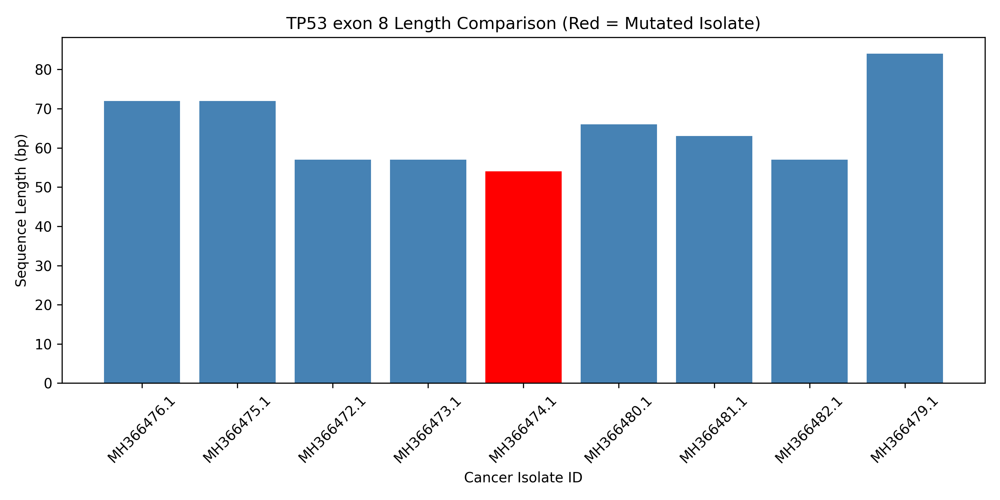

# TP53 Cancer Gene Mutation & Variant Analysis

This repository contains a complete bioinformatics workflow to clean, analyze, and visualize sequence variations in the **Human TP53 (Exon 8)** tumor suppressor gene across clinical isolates.

## Tools & Technologies Used
* **Command Line & Data Filtering:** Linux (Ubuntu), 'seqkit'
* **Programming & sequence Analysis:** Python 3,  'Biopython'
* **Data Visualization:** 'Matplotlib'

* ## Key Scientific Findings
* **Data Filtering:** Filtered out non-target regions (Exon 5) from raw NCBI datasets to isolate 9 pure Exon 8 clinical samples.
* **Conserved Motif Check:** Verified the presence of the conserved 'GGGAGCCT' motif across all isolates.
* **Mutation Detection:** Identified a specific sequence mismatch (SNP/Mutation) in isolate **'MH366474.1'** (54 bp) compared to the 84 bp reference sequence ('MH366479.1').

* ## Visualization
* 
* 
